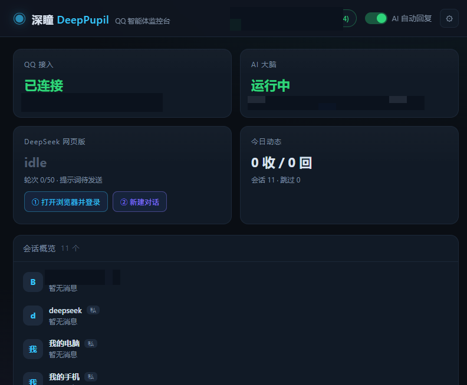
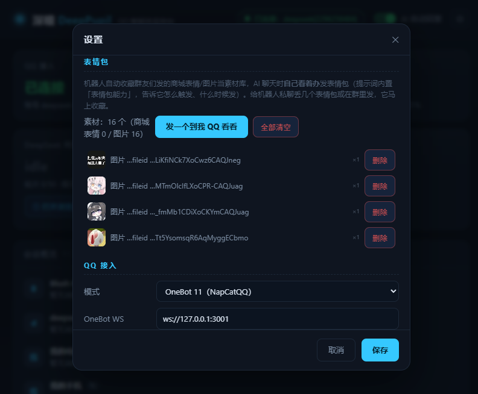
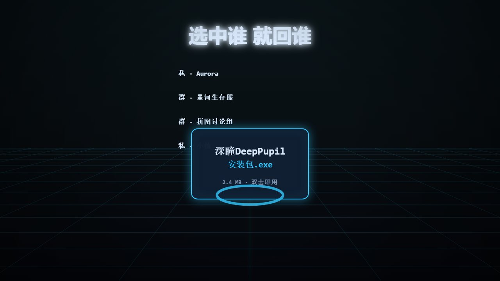

# 摸鱼瞳 MoYuTong

> 你 QQ 背后的 AI 搭子 —— 本地运行 · 免 API Key · AI 会自己发表情包

摸鱼瞳通过 **OneBot 11**（SnowLuma / NapCat 等任意实现）接入你真实的 QQ 账号，用**网页版大模型**当大脑替你自动应答；同时内置网页监控台，连接状态、回复记录、表情包素材全部可视化。Windows 安装包约 141 KB，双击即用。



## ⚠️ 声明 —— 风险与利益共存，一分钱一分货

**这是个玩具级学习作品，不是生产级产品。请你清楚自己在做什么。**

- **轻量但有限**：整个程序约 141 KB，零 npm 依赖，靠你本机的 Node.js + Edge 跑起来。**只能当玩具玩 / 学习交流，不可用于生产环境**，不承诺任何稳定性。
- **无安全措施**：它会把 **DeepSeek 生成的文本自动发到 QQ 群聊**，没有审核、没有黑名单、没有人工确认。生成内容可能不当，**发出去收不回来**。
- **违反 DeepSeek 用户协议**：本项目**不是反代、没有第三方中转、没有逆向 DeepSeek 网页**。原理是用 Node 连接本机浏览器调试端口（CDP），在页面里执行 JS 模拟输入与发送。**这与反代一样均违反 DeepSeek 用户协议，账号可能被临时限制或封禁。**
- **QQ 风控**：高频发消息/发图是风控大头。内置了最小间隔、批量单条、40 秒冷却、免打扰时段等护栏，**但请勿用于骚扰、刷屏、恶作剧，建议用小号。**
- **杀软误报**：NSIS 打包 + 运行时会自动拉起 Edge 并连接调试端口，符合部分杀软对「远控/自动化脚本」的启发式判定，**可能误报木马**。作者保证源码不含任何恶意代码，欢迎自行审计。
- **隐私**：数据只在本机 `D:\摸鱼瞳\data`，**无任何遥测与联网上传**；但 DeepSeek 那边能看到你的对话。
- **仅供学习使用**：**本软件仅学习使用，请在 24h 内删除。** 它是玩具，试过就好。MIT 协议并不禁止你留着——删不删由你，作者只是希望它别被拿去干正经事，也别被拿去干坏事。
- **责任自负**：作者不承担任何责任（账号被封、群被踢、损失、纠纷等）。

> 📄 完整版声明见 **[docs/免责声明.md](docs/免责声明.md)** · 侵权 / 投诉 / 合作：**1413214574@qq.com**（48 小时内响应）
>
> MIT © 2026 MoYuTong contributors · 创建于 2026 年 10 月

## 🙋 关于作者

**本人还是个高中生**，做这个纯属个人兴趣，水平有限、代码也糙。

- **需求、问题、Issue 我大概率不会回复**，只有**休息日**才看消息，请多包涵
- 不是已读不回，是**真的没看到**——周一到周五我基本不看手机
- 想让我一定看到的话，走邮箱：**1413214574@qq.com**（这个反而比 Issue 靠谱）

### 🎯 但功能我会加 —— 前提是你先提建议

摸鱼瞳是我一个人闷头想出来的，能想到的早就想完了。**你提的点子才是它变好的方向。**

> **提建议多的人可以进内测群** —— 新功能、新版本先在群里发，抢鲜试用，遇到 Bug 直接找我，不用排队等公开版。

**怎么提才有用**：在群或 Issue 里说清楚「**你想用它解决什么场景**」，比堆一串功能名词有用一百倍。

- ✅「我想让它在我打游戏的时候自动静音」→ 有场景，我能判断值不值得做
- ❌「加个 AI 功能」「加个皮肤」→ 说了等于没说

所以：**别提 PR 期待我合并**（我没时间看 diff），但**建议尽管提，认认真真提的我都记着**。
想自己动手改也行，MIT 协议摆在这儿，随便 fork。

## 🎬 40 秒宣传片

[▶ 官网观看](https://blushhorizon.github.io/MoYuTong/#films) · 视频源文件在 `site/assets/moyutong-promo.mp4`

<video src="https://blushhorizon.github.io/MoYuTong/assets/moyutong-promo.mp4" controls muted loop playsinline width="100%"></video>

> 配乐由 JS 合成器现场合成（150 BPM 电子舞曲），画面 canvas 逐帧渲染——零素材、零剪辑软件。

## 亮点

- **网页版 DeepSeek 直连，免 API Key**：不需要任何 Key，不产生任何 API 账单；用浏览器驱动（CDP）像人一样操作 DeepSeek 网页版。设置里可切换站点档案（新增站点 = 在 `server/web-sites.js` 加一条档案）
- **表情包引擎（核心特性）**：自动收藏所有来信中的商城表情/图片并**下载本地副本**（QQ 图链会过期，本地副本不会）；AI 回复里写 `[表情]` / `[表情:关键词]` 标记就自动发表情包，一条回复可三连，多个表情包**打包成同一条消息**发出，不会触发刷屏风控；面板里可视化增删
- **只回该回的人**：「指定会话」支持**多选**（Ctrl 点选），选中的会话全部回复，其他一律不回；一个都不选 = 全部回复
- **群聊规矩全套**：需 @ 才回、关键词过滤、非 @ 主动回复概率、自动 @ 触发者、引用原消息、群聊/私聊范围
- **看图回复**：收到图片自动下载后交给 DeepSeek 看图再回（可关）
- **免打扰 + 远程指令**：设定时段自动闭嘴；主人在 QQ 里发 `/状态` `/暂停` `/帮助` 即可管理
- **实时监控台**：网页看板通过 SSE 实时推送消息与回复
- **干净**：零 npm 依赖（Node ≥ 22 内置能力）、无插件、无商城，一个安装包搞定



## 安装与使用

1. 下载安装包（Releases 里的 `摸鱼瞳MoYuTong安装包.exe`），默认装到 `D:\摸鱼瞳`，覆盖安装不丢数据
2. 启动任意 OneBot 11 机器人端（如 SnowLuma / NapCat），面板里填 WS 地址（默认 `ws://127.0.0.1:3001`）
3. 双击「开启.bat」，浏览器打开监控台 → 点「① 打开该网站」扫码登录一次 DeepSeek 网页版，之后它自己开工

系统要求：Windows 10/11 + Edge/Chrome + 一台 QQ（建议小号）+ OneBot 11 机器人端。

## 目录结构

```
MoYuTong/
├─ app/                  软件本体（零依赖 Node 服务 + 监控台前端 + NSIS 打包）
│  ├─ server/            server.js / ai.js / deepseek-web.js / web-sites.js / stickers.js / qq-adapter.js …
│  ├─ public/            监控台页面（index.html / app.js / style.css）
│  ├─ dist/              安装包打包源（与 server/public 同步）
│  ├─ setup.nsi          NSIS 安装脚本
│  ├─ launcher.ps1       启动器（开启/关闭/重启服务）
│  └─ config.json        配置（首次运行自动生成）
├─ site/                 官网（纯静态，双击 index.html 即可）
├─ mv/                   MV 全部由代码生成：mv.html 画面 + make-wav.js 配乐合成
│  └─ out/               moyutong-mv.mp4 成片 / music.wav 配乐
└─ docs/技术文档.md      详细技术文档（架构、接口、协议、故障排查）
```

## 本地开发

```bash
cd app
node server/server.js       # 或 Windows 下双击 start.bat
# 打开 http://127.0.0.1:8787
```

- 无第三方依赖：浏览器控制走 Chrome DevTools Protocol（CDP），WebSocket 用 Node ≥ 22 的全局 `WebSocket`
- 网页站点档案在 `server/web-sites.js`，新增站点 = 加一条档案（选择器、输入框、发送键等都写在里面）
- 构建安装包：装 [NSIS](https://nsis.sourceforge.io/)，在 `app/` 下执行 `makensis setup.nsi`，产物默认输出到安装包目录

## 官网与 MV

- `site/`：纯静态官网，零外部依赖，双击 `index.html` 即可打开（内嵌 MV 视频与安装包下载）
- `mv/`：这支 MV 没有用任何剪辑软件——配乐是 `make-wav.js` 现场合成的 120 BPM 合成波，画面是 `mv.html` canvas 逐帧离格渲染（`node capture.js 24` 抓帧），`redact.js` 给截图打码。想改歌词/配色直接改 `mv.html` 重跑即可



## 隐私

- 所有数据都在你自己的机器上：`D:\摸鱼瞳\data`（聊天记录、表情包库、浏览器登录态、日志），**没有任何遥测与联网上传**
- 本仓库已剔除全部个人数据（QQ 号、群号、真实会话名、聊天记录、浏览器登录态、日志），`config.json` 为出厂默认

> ⚠️ 自动化回复有触发 QQ 风控的可能（高频发消息/发图）。摸鱼瞳内置了最小回复间隔、表情包批量单条、40 秒冷却、免打扰时段等护栏，但请自行控制频率、遵守平台规则，**请勿用于骚扰**。建议使用小号。

## 免责声明

本项目与 QQ / DeepSeek 官方无关；各网站的结构变更可能导致网页驱动需要调整（站点档案集中在一个文件里，便于跟进）。使用者需自行确保行为符合所在平台的服务条款与当地法律法规。

## License

MIT © MoYuTong contributors